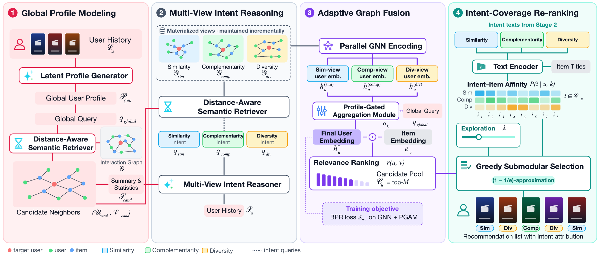

# MIRAGE-DKE

Implementation accompanying **Multi-intent reasoning and coverage for graph-based recommendation**, the journal extension of MIRAGE (DEXA 2026).

MIRAGE generates a global user profile and Similarity, Complementarity, and Diversity descriptions. These descriptions retrieve graph views for profile-gated recommendation and are reused by an intent-coverage re-ranker. The DKE code also includes materialized-view training, incremental view maintenance, and beyond-accuracy evaluation.



## Installation

Use Python 3.10 or later and install the dependencies:

```bash
python -m venv .venv
source .venv/bin/activate
pip install -r requirements.txt
```

Install the PyTorch build suitable for your CPU or CUDA environment. Profile and intent generation uses an OpenAI-compatible endpoint. The optional re-ranking text encoder is served through an Ollama-compatible `/api/embed` endpoint; the default is BGE-M3.

## Data layout

The code uses the LLMRec-preprocessed Netflix and MovieLens-1M data. Obtain source datasets under their respective terms; datasets, trained checkpoints, and generated user artifacts are not bundled here.

Provide one directory per dataset:

```text
data/netflix_data/
  train_mat
  train.json
  val.json
  test.json
  netflix_image_text/item_attribute.csv
  lpg_latent_profile_dict
  lpg_global_profile_embedding
  mvir_multi_view_intent_dict
  mvir_multi_view_intent_embedding
  text_embeddings.npz
```

`train_mat` is a pickled SciPy sparse user-item matrix. Split files map user IDs to item-ID lists. IDs must match the matrix indices. The item-attribute CSV contains `id`, `year`, and `title`; the re-ranking encoder reads the headerless LLMRec-style layout. The profile and intent files are generated artifacts. A `text_embeddings.npz` file containing `item` and `intent` arrays is required for re-ranking.

- [MovieLens-1M](https://grouplens.org/datasets/movielens/1m/)
- [Netflix Prize data](https://www.kaggle.com/datasets/netflix-inc/netflix-prize-data)
- [LLMRec preprocessing and implementation](https://github.com/HKUDS/LLMRec)

## Workflow

Set credentials in your environment before running offline generation:

```bash
export OPENAI_API_KEY=YOUR_KEY
python generate_embeddings.py --data_dir data --dataset netflix_data
python encode_texts.py --data_dir data --dataset netflix_data --model bge-m3
```

Train the retriever, materialize views, and train the recommendation model:

```bash
python main.py --data_dir data --dataset netflix_data --stage retriever
python main.py --data_dir data --dataset netflix_data --stage materialize --top_k 1000
python main.py --data_dir data --dataset netflix_data --stage train --top_k 1000
```

Evaluate the backbone and then apply intent-coverage re-ranking:

```bash
python main.py --data_dir data --dataset netflix_data --stage evaluate --lam 0
python main.py --data_dir data --dataset netflix_data --stage evaluate --lam 0.5 --pool 200 --n 20 --gamma 1 --cap 0.1
```

Use `--mode sim_only` consistently across materialization, training, and evaluation for the Similarity-only control. `--top_k` identifies the stored-view file and must match the materialization step. The commands above illustrate the workflow; dataset-specific settings should follow the manuscript and the configurations used for the corresponding experiment.

Insert new interactions into stored views:

```bash
python main.py --data_dir data --dataset netflix_data --stage update --interactions new_interactions.json
```

The update file maps user IDs to lists of new item IDs. This stage maintains selected view membership and reports the users whose subgraph contents need refreshing. Rebuild training components from the updated interaction matrix before subsequent training. `--stage all` retains the original non-materialized training path.

## Modules

| File | Role |
| --- | --- |
| `llm_agent.py`, `generate_embeddings.py` | Offline profile/intent generation and encoding |
| `models.py`, `trainer_retriever.py`, `trainer_gnn.py` | Retrieval, graph encoding, profile gating, and original training |
| `materialize.py`, `trainer_batched.py` | Stored-view selection, disjoint batching, and local membership updates |
| `encode_texts.py`, `rerank.py` | Shared-space text encoding and greedy intent coverage |
| `metrics.py` | Accuracy, novelty, long-tail share, unexpectedness, serendipitous recall, coverage, and Gini |

Training checkpoints and early stopping are selected using `val.json`; final evaluation uses `test.json`.

## Citation

The conference framework is described in:

```bibtex
@inproceedings{ren2026mirage,
  author = {Ren, Baofeng and Yang, Tianyuan and Gu, Chenghao and Ma, Boxuan and Konomi, Shin'ichi},
  title = {MIRAGE: Multi-intent Reasoning and Adaptive Graph Embedding for Recommendation},
  booktitle = {Database and Expert Systems Applications},
  year = {2026},
  pages = {149--164},
  doi = {10.1007/978-3-032-34374-1_11}
}
```

The journal manuscript title is *Multi-intent reasoning and coverage for graph-based recommendation*. Publication details will be added when available.
